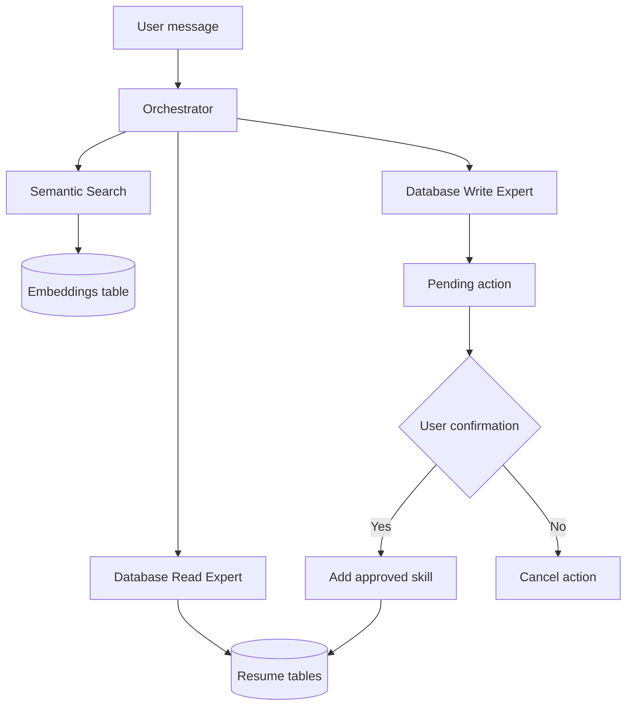

# Design and Testing Report — Homework 2

**Name:** Jumana Alkafarna  
**GitHub fork/branch URL:** https://github.com/JomanaElkafarna/ai-agents/tree/HW2/Jumana 
**Demo video link:**  
**Command that runs my tests:** `python -m unittest discover -s "homework 2\tests" -v` (21 automated tests passed: 5 approval tests, 8 embedding/search tests, 1 persistence test, 1 fixture-loading test, and 6 orchestrator tests).

## 0. Starting point

My HW1 application needed several fixes before completing HW2. I fixed database initialization and application startup issues, configured Python 3.13, and added Groq and FastEmbed dependencies. I also implemented embedding synchronization during startup. The application now starts successfully, the database initializes, and embedding synchronization completes.

## 1. How my system works

### System diagram



### Main components

- **Orchestrator:** Routes user requests to the appropriate expert and coordinates the response.
- **Semantic Search:** Uses FastEmbed with `BAAI/bge-small-en-v1.5` to retrieve relevant resume information by meaning.
- **Database:** Uses SQLite to store resume records and embeddings.
- **Database Read Expert:** Generates read-only SQL queries to retrieve structured information.
- **Database Write Expert:** Supports adding a skill through a pending action that requires user confirmation.

**Changes from HW1:** I added semantic search, an embeddings table, startup embedding synchronization, Groq integration, and an approval step for adding skills.

## 2. Where to find things in my code

| What | File / function / table |
|---|---|
| Semantic search | `flask_app/utils/embeddings.py` — `semantic_search()` |
| Orchestrator and expert execution | `flask_app/utils/llm.py` — `run_orchestrator_plan()` |
| Read-only database queries | `flask_app/utils/llm.py` — `execute_read_query()` |
| Write action generation | `flask_app/utils/llm.py` — `execute_write_action()` |
| Approval handling | `flask_app/utils/llm.py` — `process_pending_action()` |
| Embeddings storage | SQLite `embeddings` table |
| Configuration example | `homework 2/.env.example` |
| Automated tests | Five test files covering approval handling (5), embedding/search (8), persistence (1), fixture loading (1), and orchestration (6): 21 tests passed. |

## 3. Three decisions I made

| Decision | Options considered | What I chose | Why and trade-off |
|---|---|---|---|
| Embedding model | Hosted or local embeddings | FastEmbed with `BAAI/bge-small-en-v1.5` | Local processing avoids an external embedding API, but requires local installation and resources. |
| Search method | Exact SQL or semantic search | Semantic search for meaning-based questions and SQL for structured questions | This supports natural-language questions while keeping exact database queries reliable. It adds complexity. |
| Write permissions | General database writes or restricted operations | Allow adding a skill only after explicit confirmation | This reduces accidental changes, but deletion and other write operations are not supported. |

## 4. Testing

The following scenarios were executed manually using PowerShell commands. Automated unit-test coverage is summarized above and includes the scenarios described in the test files.

| Scenario / what I tested | Expected result | Actual result | Status | Evidence |
|---|---|---|---|---|
| Application startup | Database initializes and embeddings synchronize | Application startup completed successfully | Pass | Terminal output: `APPLICATION STARTUP SUCCESS` |
| S1 — Ask about experience at MSU | Do not confuse a similar institution with MSU | System reported that no MSU experience was found | Pass | PowerShell test output |
| S4 — Ask for education institution and department | Execute two dependent database read steps | Returned Arab Open University and Computer Science | Pass | PowerShell test output |
| S5 — Add a skill | Ask for confirmation before saving | System created a pending action and requested confirmation | Pass | PowerShell test output |
| S5 — Reject the addition | Cancel without changing the database | Returned `Cancelled. No database changes were made.` | Pass | PowerShell test output |
| S8 — Unclear response (`maybe`) | Keep the pending action waiting for confirmation | Pending action remained unchanged | Pass | PowerShell test output |
| S8 — Change the subject | Cancel the pending action | Pending action became `None` | Pass | PowerShell test output |
| S10 — Simulated embedding failure | Report the failure without inventing results | Returned `Semantic search failed: SIMULATED EMBEDDING FAILURE` | Pass | PowerShell test output |
| S11 — Ask about missing Harvard experience | Report missing information honestly | Returned that the information was not found in the resume database | Pass | PowerShell test output |

**Testing note:** The approval, unclear-response, and cancellation tests included direct setup of a pending action in the test command. The skill-addition request also confirmed that the system asks for approval before saving.

**Surprises and issues:** The application initially had startup and database initialization problems. I fixed these issues. I also found that a SQL safety check rejected a valid query ending in a semicolon. I updated the check to allow one optional trailing semicolon while continuing to reject multiple statements and SQL comments.

## 5. Limitations

1. **Limited write operations:** The system supports adding skills and deleting a specific skill after confirmation. Editing other records is not implemented. I would improve this by adding validated operations with explicit confirmation.

2. **Limited automated coverage:** Twenty-one automated tests cover pending-action approval handling, embedding validation, cosine similarity, record embedding, semantic-search ranking and limits, embedding persistence, fixture loading, orchestration routing, dependent steps, and bulk-delete blocking. The complete S1–S11 end-to-end suite is not yet implemented.

3. **Skill-level conversion:** During testing, the requested level `Beginner` appeared in the confirmation message as `3`. This needs further investigation to ensure the displayed level matches the user's requested level.

## 6. My work and the help I used

I worked on modifying the Flask application, database integration, embedding synchronization, and AI orchestration. I configured Groq for language-model requests and FastEmbed for semantic search. I reused the provided starter project and its existing resume database structure. I also used project documentation, Python libraries, and AI assistance to understand errors and implement changes. I reviewed the code and manually tested application startup, database retrieval, semantic search, and approval handling.

## 7. How to run it

### Setup and run (Windows PowerShell)

Run these commands from the project root folder:

```powershell
.\.venv313\Scripts\Activate.ps1
python -m pip install -r requirements.txt
```

For a fresh setup, create `.env` from `.env.example`:

```powershell
Copy-Item "homework 2\.env.example" "homework 2\.env"
```

Add the required `GROQ_API_KEY` to `homework 2/.env`. Do not commit the `.env` file or expose the API key.

Start the application:

```powershell
python "homework 2\app.py"
```

Open the local Flask address shown in the terminal and test questions through the chat interface.

**Test data reset:** A separate safe test-data reset command has not been implemented. Do not delete the database or change database initialization settings without backing up the data first.


